<!-- ===== HEADER ===== -->

  

  

  
  

  
  
  
  

  <a href="#about">About</a> &nbsp;|&nbsp;
  <a href="#workflow">Workflow</a> &nbsp;|&nbsp;
  <a href="#expertise">Expertise</a> &nbsp;|&nbsp;
  <a href="#tech-stack">Tech Stack</a> &nbsp;|&nbsp;
  <a href="#featured-projects">Projects</a> &nbsp;|&nbsp;
  <a href="#github-activity">Activity</a> &nbsp;|&nbsp;
  <a href="#collaboration">Contact</a>

---

## About

I am a civil servant at **Statistics Indonesia (BPS), Lampung Province**, working in the **IPDS Division** (*Integration, Processing, and Dissemination of Statistics*) since completing my undergraduate degree in 2024.

My work sits where **official statistics, the environment, and technology** meet. I build web applications that simplify day-to-day office work, and I apply **remote sensing, machine learning, deep learning, and geospatial AI (GeoAI)** to produce official data that is better, faster, and more granular.

<table>
  <tr>
    <td width="50%" valign="top">

**Role**  
IT Specialist, IPDS Division  
BPS - Statistics Indonesia, Lampung Province

**Focus**  
Environmental and official statistics

**Currently learning**  
Satellite image classification with deep learning

   </td>
   <td width="50%" valign="top">

**Core interests**  
Remote Sensing, GeoAI, Machine Learning, Deep Learning, Web Development

**Long-term goal**  
Help public and private sectors build remote sensing applications for official data and the environment

**Open to**  
Collaboration, research, and international networks

   </td>
  </tr>
</table>

---

## Workflow

How I approach turning earth observation data into official statistics:

  

---

## Expertise

<table>
  <tr>
    <td width="50%" valign="top">

### Remote Sensing and GeoAI
Satellite image processing, land cover classification, and deep learning for earth observation.

   </td>
   <td width="50%" valign="top">

### Web Application Development
Serverless and lightweight web apps that streamline administrative workflows in government offices.

   </td>
  </tr>
  <tr>
    <td valign="top">

### Data Processing
Cleaning, integrating, and publishing statistical data for dissemination.

   </td>
   <td valign="top">

### Machine Learning
Applying ML and DL models to produce more granular official statistics.

   </td>
  </tr>
</table>

---

## Tech Stack

<table>
  <tr>
    <td width="200"><b>Languages</b></td>
    <td></td>
  </tr>
  <tr>
    <td><b>Frameworks and Libraries</b></td>
    <td></td>
  </tr>
  <tr>
    <td><b>Databases</b></td>
    <td>
       
      
      
    </td>
  </tr>
  <tr>
    <td><b>Machine and Deep Learning</b></td>
    <td>
       
      
      
      
      
    </td>
  </tr>
  <tr>
    <td><b>Geospatial and Remote Sensing</b></td>
    <td>
      
      
      
      
      
      
      
    </td>
  </tr>
  <tr>
    <td><b>Cloud and Tools</b></td>
    <td>
       
      
      
      
    </td>
  </tr>
</table>

---

## Featured Projects

<!-- Replace the placeholders with your best repositories. Pin them on your profile too. -->

<table>
  <tr>
    <td width="33%" valign="top">

**[project-name](https://github.com/thoms0504/project-name)**  
Short description of the problem solved and the impact.  
`Python` `Google Earth Engine` `TensorFlow`

   </td>
   <td width="33%" valign="top">

**[project-name](https://github.com/thoms0504/project-name)**  
Short description of the problem solved and the impact.  
`Google Apps Script` `JavaScript`

   </td>
   <td width="33%" valign="top">

**[project-name](https://github.com/thoms0504/project-name)**  
Short description of the problem solved and the impact.  
`Laravel` `MySQL`

   </td>
  </tr>
</table>

---

## GitHub Activity

  

  

  
  

  
<b>Pac-Man eats my contributions</b>

   
  

    <picture>
      <source media="(prefers-color-scheme: dark)" srcset="https://raw.githubusercontent.com/thoms0504/thoms0504/output/pacman-contribution-graph-dark.svg"/>
      <source media="(prefers-color-scheme: light)" srcset="https://raw.githubusercontent.com/thoms0504/thoms0504/output/pacman-contribution-graph.svg"/>
      
    </picture>
  

---

## Collaboration

I am open to discussions and collaboration on:

- Remote sensing and GeoAI for official statistics and environmental monitoring
- Satellite image classification with deep learning
- Web-based tools for public sector data workflows
- Research and international networks

  
  

<!-- ===== FOOTER ===== -->

  

